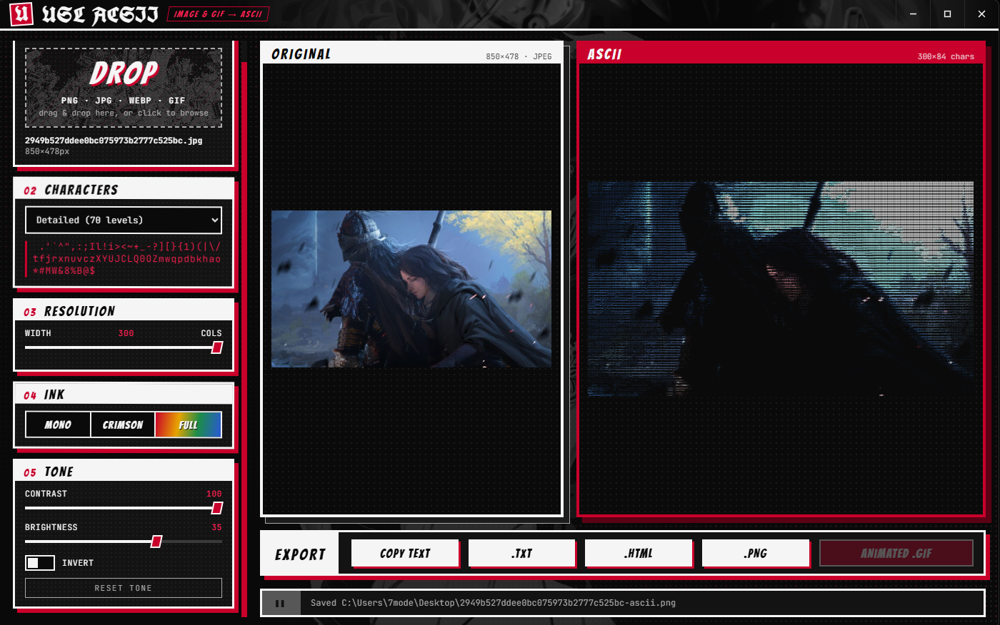
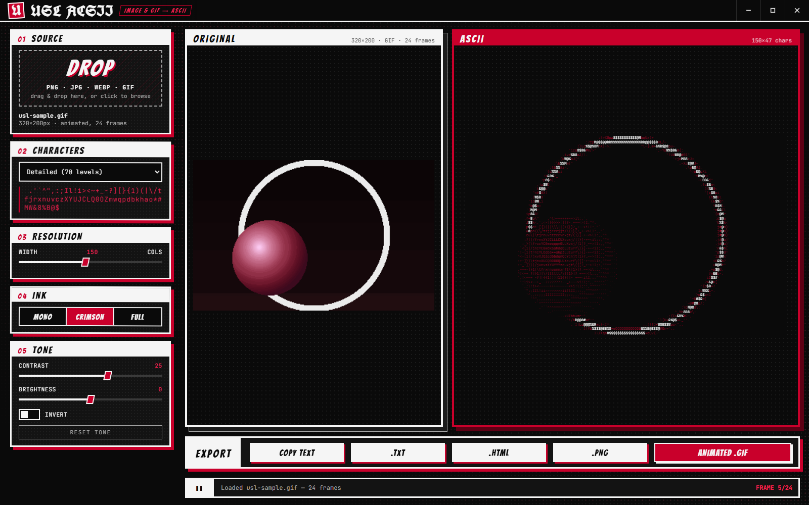
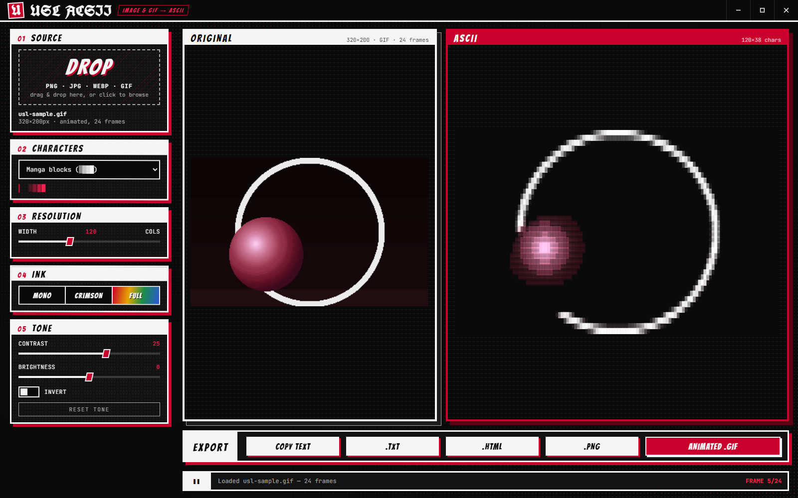

# USL ACSII

**Turn any image or animated GIF into ASCII art**

[**⬇ Download the latest beta**](https://github.com/pzxe/USL-ACSII/releases) · [Report a bug](https://github.com/pzxe/USL-ACSII/issues)

## Features

- **Drag & drop, browse or paste** — PNG, JPG, WEBP and multi-frame animated GIFs.
- **Live preview** — original and ASCII side by side; GIFs animate frame by frame with their real timings.
- **Character sets** — Detailed (70 levels), Standard (10), Manga blocks (`░▒▓█`) or your own custom characters.
- **Resolution** — 20–300 columns, with correct character aspect-ratio handling.
- **Ink modes** — Monochrome (black & white manga), Crimson accent, or Full colour.
- **Tone controls** — contrast, brightness and invert.
- **Export engine**
  - Copy to clipboard as raw text
  - `.txt` raw text
  - `.html` — self-contained, dark background, embedded font for exact spacing (animated for GIFs)
  - `.png` — high-resolution render
  - animated `.gif` — every ASCII frame rendered into a looping GIF
- **Manga-panel interface** — Ink Black `#0a0a0a`, Paper White `#f5f5f5`, Kagune Crimson `#c9002b`, sharp panel frames, halftone screentones and a custom title bar.

| Crimson · Detailed charset | Full colour · Manga blocks |
| :---: | :---: |
|  |  |

## Download & Installation

Download the latest build from the **[Releases page](https://github.com/pzxe/USL-ACSII/releases)**:

- **Portable** — `USL-ACSII-<version>-portable.exe`: a single file, no installation needed.
- **Installer** — `USL-ACSII-Setup-<version>.exe`: adds a Start-menu shortcut and uninstaller.

Requires Windows 10/11 (x64). The executables are not code-signed, so SmartScreen may warn you: choose **More info → Run anyway**.

> Manga background art is not bundled. On first launch the app downloads it to your own user profile, and falls back to a built-in halftone look when offline.

---

USL ACSII is an unofficial fan-made tool and is not affiliated with Sui Ishida or Shueisha.
